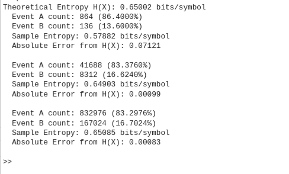
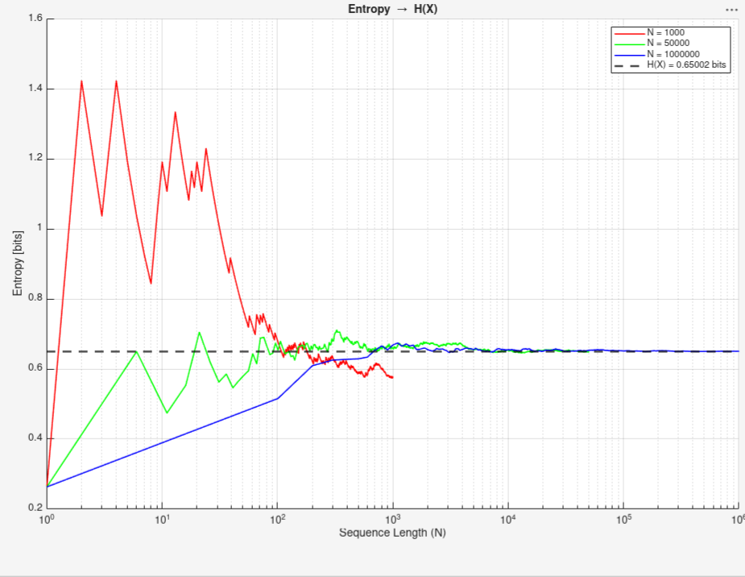

## Introduction

Took a while to finally sit down and write another post, this is going to be a bit of a short one. Today we will scale the idea of entropy to largest limits which would be the abstract number of infinity.

## Law of Large Numbers

Referring to the weak (more important of the two, btw) law of large numbers which I will abbreviate to WLLN for writing simplicity.

In probability, for every $\epsilon > 0$:

$$
\Pr\left\{ \left| \frac{1}{n}\sum_{i=1}^{n} X_i - \mathbb{E}[X] \right| > \epsilon \right\} \to 0 \quad \text{as } n \to \infty
$$

This may look complicated but what it is trying to say is that the probability that our sample entropy would be missing out from the true theoretical entropy by more than any tiny amount ($\epsilon$) would shrink down to zero as sequence length $N$ converges to infinity.

now if we want sureness that our sample entropy that we have obtained is the same as the theoretical value, we would have to abide by the **STRONG** law of the same rule which is not relevant for our application today (small spikes are usually permissible).

Ok so now what?

Let us introduce the second topic for today then, shall we?

## AEP 

Also known as Asymptotic Equipartition Property which states that

$$
\frac{1}{n} \log \frac{1}{\Pr(X_1, X_2, \ldots, X_n)}
$$

is close to its entropy $H$, where $X_1, X_2, \ldots, X_n$ are i.i.d. (independent and identically distributed) random variables

so the Probability _can be_ estimated to $2^{-nH}$

the last 4-5 sentences may have made no sense, specifically why the last one did, so let's see why it can be simplified as such.

functions of i.i.d. random variables are also i.i.d. random variables and since $X_i$ are also random variables then so are the product of the logarithm by its $\Pr(\cdot)$ as well!
thus by WLLN:-

$$
\begin{aligned}
-\frac{1}{n} \log p(X_1, X_2, \ldots, X_n) &= -\frac{1}{n} \sum_{i} \log p(X_i) \\
&\to -\mathbb{E} \log p(X) \\
&= H(X)
\end{aligned}
$$

<p class="-mt-2 text-center text-sm text-gray-500 italic dark:text-gray-400">the value can be obtained by simply taking the antilog of the equation which will obtain the same expression as before</p>

This is quite an important property which is crucial for understanding data compression & effectiveness of source-coding. For small finite cases where we can visualize and make practical conclusions for how information can be transmitted, we would want the same or at the _very least_ **similar levels of sureness** especially when we scale it to larger numbers. I hope now all the things blurted in the first few sentences make somewhat of a connection now.

## Experiment 

Taking a very basic setup, usually people take an example of a biased coin but I have never seen a biased coin myself so I would infer a setup of an 'unfair' die where 5 of its sides are numbered to the value '6' whereas the remaining one side has the value '1'.

Since we know from basic probability that the occurrence of 6 will now be 5/6 which is roughly 83.33% of the times whereas the occurrence of 1 is only the remainder which is 16.67%.

So if I were to ask you each time I roll a die, what is the likelihood that the die would give me a 6, it is almost certain that your answer would be 6 nearly each time with a gut feeling that eventually maybe this time '1' _could_ occur.

Why is it not fair to think that if the individual likelihood of an event happening is always greater than the alternatives especially when the gap is this large, why can't for all possible rolls, we obtain the same dominant option.

Now by simple intuition and even basic probability distribution knowledge, we can derive why it is impractical to imagine but let's maybe rephrase this question to something that could be a brainteaser:

could it be possible that for 10,000 independent rolls, we obtain the same percentage of 6's and 1's that we would be arriving at individual case? (i.e. 8333 sixes and remaining being ones)

Take your time and maybe even present your viewpoint in the comment-section (which is thankfully working now) on what you feel your answer should be in this case.

<p class="-mt-2 text-center text-sm text-gray-500 italic dark:text-gray-400">getting exactly 8,333 sixes in 10,000 rolls has probability of only about 1%, roughly 1/√(2π·n·p·q), also why AEP is phrased with ε.</p>


Shoutout to DSP-Lab which forced me to learn MATLAB, I am going to proceed to simulate cases with each scenario being larger than the previous one, so let's begin then

```matlab
% situation we discussed right now 
pr_a = 5/6; % Outcome 6
pr_b = 1/6; % Outcome 1
H_X = -(pr_a * log2(pr_a) + pr_b * log2(pr_b));
% cases
simulations = [1000, 50000, 1000000];
num_sims = length(simulations);
```

The WLLN and AEP will actually help in theoretically proving why the individual probabilities would also reflect across larger sequences.

```matlab
for k = 1:num_sims
    N = simulations(k);

    % generate i.i.d. uniform random numbers
    randomRolls = rand(1, N);
    % vectorized assignment
    is_event_a = randomRolls < pr_a;
    counter_a = sum(is_event_a);
    counter_b = N - counter_a;
    p_hat_a = counter_a / N;
    p_hat_b = counter_b / N;
    cum_counter_a = cumsum(is_event_a);
    cum_counter_b = (1:N) - cum_counter_a;
    cum_sample_entropy = - (cum_counter_a .* log2(pr_a) + cum_counter_b .* log2(pr_b)) ./ (1:N);
```

btw _cum_ here is shorthand for cumulative :)

## Results



Scientific method suggests to repeat three or more runs/trials of the said experiment but I believe the reader can access & run the [code](https://github.com/PranavU-Coder/convergence) and try it for themselves!

so anyways those are the raw values, let's utilize MATLAB's main purpose which is its graphing capability:



It is important to acknowledge that the entropy depends only on number of sixes so this plot is a frequency distribution rescaled.

Can you notice an underlying pattern, that entropy spikes at smaller sequences and eventually _converges_ to the theoretical value at larger sequences? 

This is because of the property of AEP (there are 4, and all are exhausting to mention and even to talk about so think of my statement as an oversimplification) which is:

"the typical set has probability above $1 - \epsilon$, contains about $2^{nH}$ sequences, and each of them is equiprobable about $2^{-nH}$"

To answer another question of ours why can't the entire sequence be filled with sixes when individual occurrence is much larger?

If we were to consider a case such as $n being 100$, its probability is $(5/6)^{100}$ which is roughly around $1.2 \times 10^{-8}$. A typical sequence is far less likely individually, about $2^{-65} \approx 2.7 \times 10^{-20}$. But there are roughly $2^{65}$ of them, out of $2^{100}$ possible sequences, and together they hold almost all the probability. All sixes has sample entropy 0.263, not 0.65, so it falls outside the typical set, **DESPITE** being the single MOST-LIKELY sequence.

So ... finally what do we learn from this experiment? that if I were to even do a billion unfair dice rolls, the probability of occurrence would again be same as its individual occurrence? 

well the fascinating part of information is that it is transferable, imagine now for a communication channel which has to reliably send messages over a channel, this property enables in understanding its effectiveness even for a given infinite duration meaning the behaviour is predictable after that duration.
via AEP, you can compress a long sequence of these rolls to about 0.65 bits per roll, and no lower (fewer bits == sehr gut!)

you could even extend this finding to my previous blog on [entropy](https://pranavu.dev/blog/entropy/) to crack/solve a cryptogram evolving from the same hangman setup and this assurance is only possible via AEP Theorem.

## Final Thoughts 

Well this blog post was unusually short, this topic was a bit complex to decipher for myself so it is totally understandable if you struggle to interpret this text as well!

I was busy with research-work thus the blog posts are a bit infrequent for the time being, expect newer blogs to come more frequently tho! 