import lockscreenWebm from './assets/lockscreen.webm'
import lockscreenMp4 from './assets/lockscreen.mp4'

## Introduction 

A new blog already!?! this can't be, posting a new blog yesterday felt so nice I decided to do it all over again today.

So today we will be talking about ricing, not to be confused with this type of [ricing](https://medium.com/@hibabutt/rice-mask-benefits-ancient-beauty-secret-for-glowing-skin-db5750fa542a) and only to be referred to this type of [ricing](https://www.youtube.com/watch?v=RuofJYG2yak)

Normally I am the type of person who believes it doesn't matter which "X" tool you use with "Y" amt of comfort or stylishness if you are able to work and deliver the product you want to. However at the same time, I will be deadass honest and say I ain't gonna like working if the setup looks something like this:

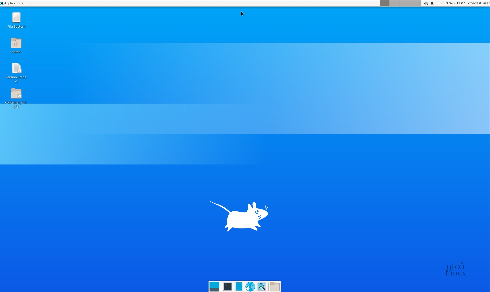
<p class="-mt-2 text-center text-sm text-gray-500 italic dark:text-gray-400">_eww brother, what is this?_</p>

Like I appreciate the 400mb RAM utilization out of 16GB available for me, but this just looks ugly (_beauty lies in the perception of the beholder_ and stuff but this is objectively low-effort and ugly)

Before I dive into my current setup, I have a bone to pick with some critics

## Complaints

Now this won't be my post if I didn't bitch about people I don't like (which comprises a vast majority of people, but for today only focusing on the ricing community)

**Minimalism**. 

I will leave this word at that, it is very frequent to hear people optimizing their desktop setup to the absolute bare-bones and the obsession is to the breaking point of minimalism almost as if it were an aesthetic. A similar issue that my [buddy](https://mooofin.github.io/portfolio/index.html?latex=1) also faced and shared similar experience to it as well. While I do understand this sentiment and I actually _do like this idea_ to have a generally minimal looking setup. Hell, even my website is minimal by design. Shout out to [enscribe](https://enscribe.dev/), amazing dev!

What I **DO NOT** like is when this same group of people will go around criticizing other people's setups saying "ughh.. what's with all these fancy animations bruv, so distracting!" and then preach about how their perceived vision of an ideal setup is what you should also be aiming for. Alright then 

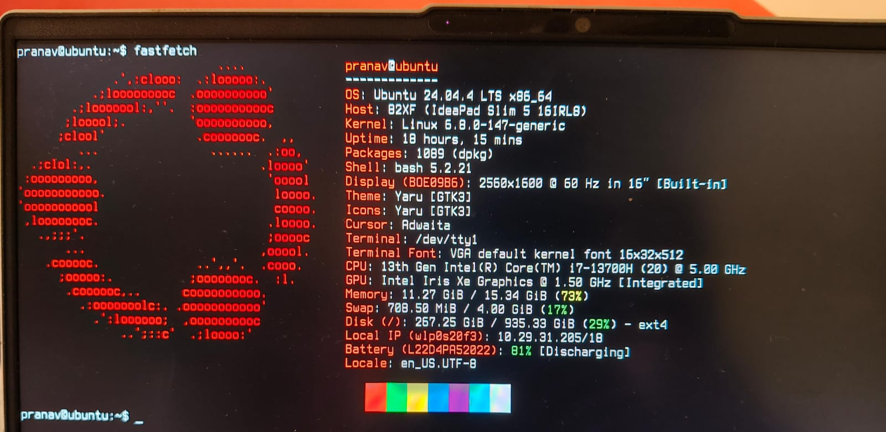
<p class="-mt-2 text-center text-sm text-gray-500 italic dark:text-gray-400">it is normally under 1GB of RAM-usage, but I have two systemd services running 24/7 with the sole purpose of acting & running as minecraft servers and some other stuff ...</p>

Why not use a setup similar to my server-laptop which is an ubuntu 24.04 LTS LVM server, [if you wanna check it out for yourself](https://www.thomas-krenn.com/en/wiki/Install_Ubuntu_24.04_LTS_Server). It seems like the final step or the logical conclusion to minimalism, why even bother with a desktop environment? or any form of graphical user interface? just hop on tty and watch youtube videos from the comfort of your void ... I mean terminal, [not joking btw](https://www.xda-developers.com/watch-youtube-from-the-terminal-because-am-man-of-culture/)

I know I am exaggerating quite a bit, but I frankly find the arguments of minimalism always so reductive and useless.

There are other gripes I also have which border on the topics of: "elitism" and so on.

> "Yo bro, NixOS is so much bet--"

Bro, Shut the fuck up, didn't ask and didn't care.

I am not going to address every single argument simply because all of them are reductive to the same premise that I just tackled right now.

Again, a gentle reminder I **DO NOT** have an issue with minimal-setups in itself, but with the people believing that it is the only correct way to rice! 

Is that clear? Alright lemme get to my setup then >_< 

## My Setup

### Lockscreen

<video autoplay loop muted playsinline>
  <source src={lockscreenWebm} type="video/webm" />
  <source src={lockscreenMp4} type="video/mp4" />
</video>
<p class="-mt-2 text-center text-sm text-gray-500 italic dark:text-gray-400">Pixel Sakura Qylock theme</p>

Man, I can't lie that when I am listing out individual components of my rice, it is sort of giving me the [card scene from a very famous movie](https://www.youtube.com/watch?v=cISYzA36-ZY) vibes but I will roll with it.

Just so comfy man, love this and is a big step up from the plain lockscreen I used to have 

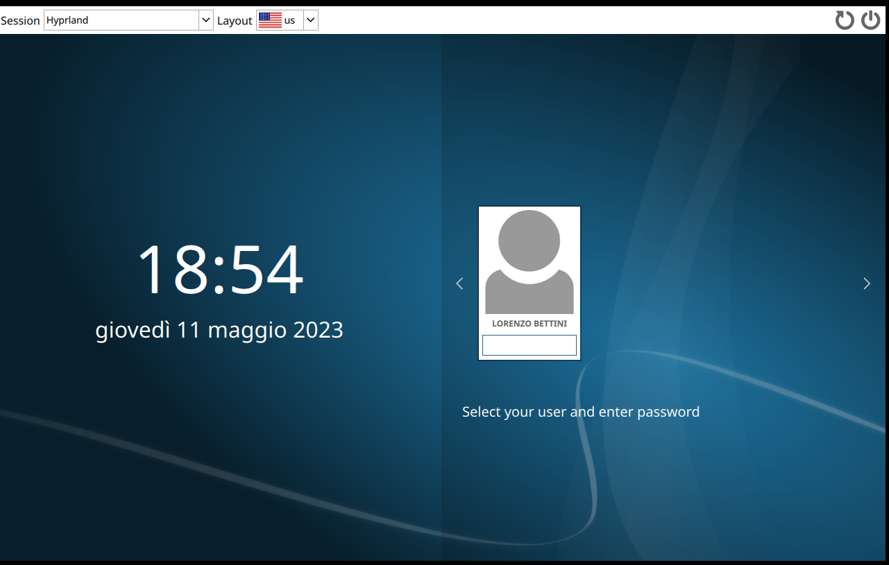
<p class="-mt-2 text-center text-sm text-gray-500 italic dark:text-gray-400">yea this one lol</p>

### QS-bar

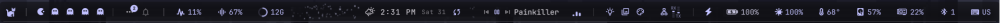
<p class="-mt-2 text-center text-sm text-gray-500 italic dark:text-gray-400">QS-Bar</p>

Looks pretty neat innit? with the kitty and the pacman appearing to swallow ghosts as indication of workspaces and which one I am on

With other utilities such as brightness, battery indicator, CPU & GPU usage so on and so forth, pretty compact and nice to look at.

### App-Launcher 

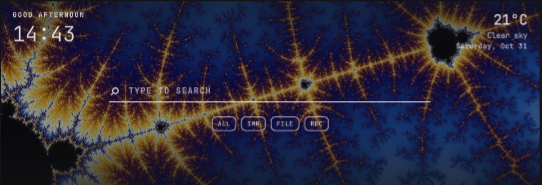

Added a fractal image cause why not? 

### Terminal 

Made a switch from my beloved ghostty to kitty :3

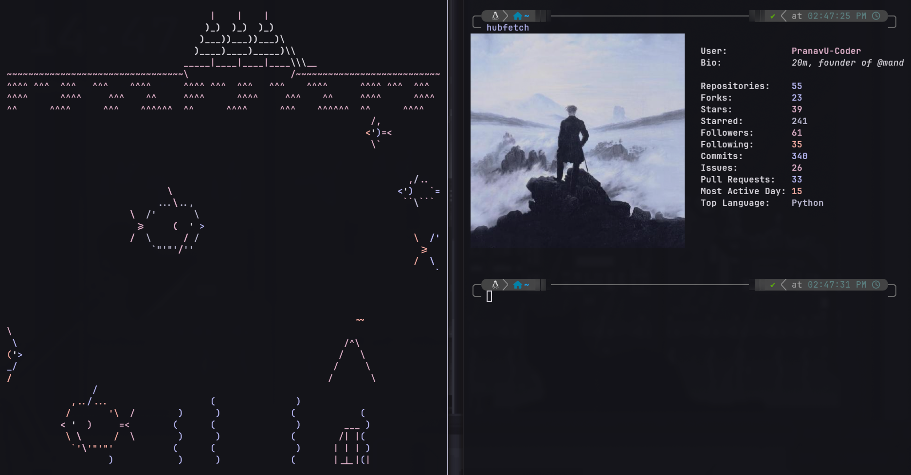

Am still using [zsh](https://ohmyz.sh/) as my shell because it is still the goat in the big/small '26, btw the tool 'hubfetch' can be installed via:

```bash
# works universally 
pipx install hubfetch 
# or if you are a fellow arch user or using a fork of arch 
yay -S hubfetch 
# alternatively
paru -S hubfetch 
```

_totally not promoting my own package, pinky promise :D_

### Fastfetch

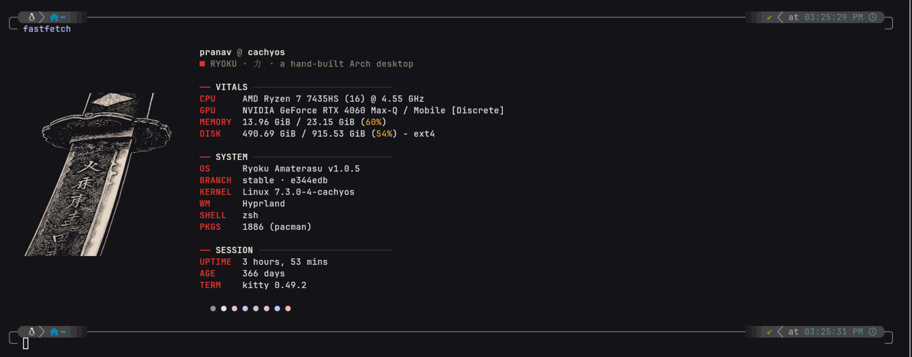

cool amirite guys?

### Overall Desktop 

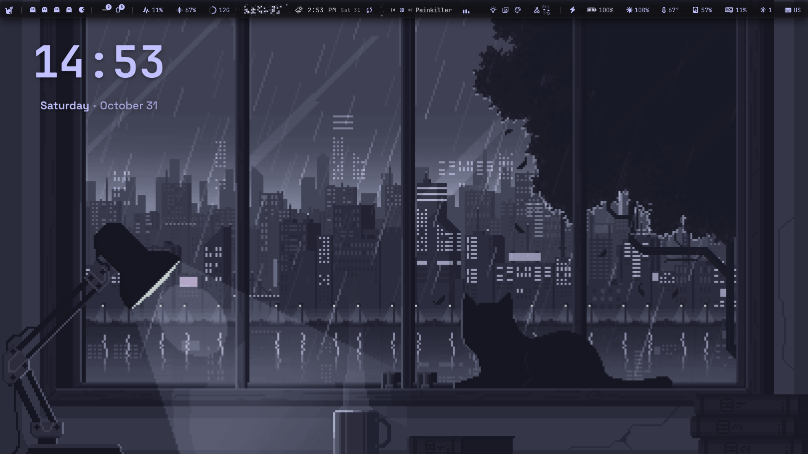

The setup is quite cozy and as you guessed it is again pixel-art :D 

also you'll observe the recurring pattern of the color-palette of [catppuccin](https://catppuccin.com/palette/), it's so goated which is why the dark theme also corresponds to this

I also dipped my toes in pixel art (by that I mean very basics, I am trash at it :< )

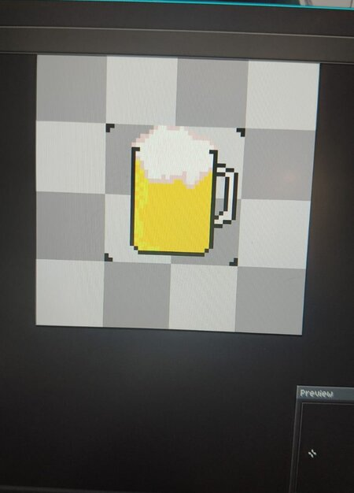
<p class="-mt-2 text-center text-sm text-gray-500 italic dark:text-gray-400">I need to start doing this again, I drew this a while back after 2nd year was over</p>

### Spotify 

Why stop at just the feel of your desktop-environment, might as well continue this perilous journey onwards to other apps such as spotify 

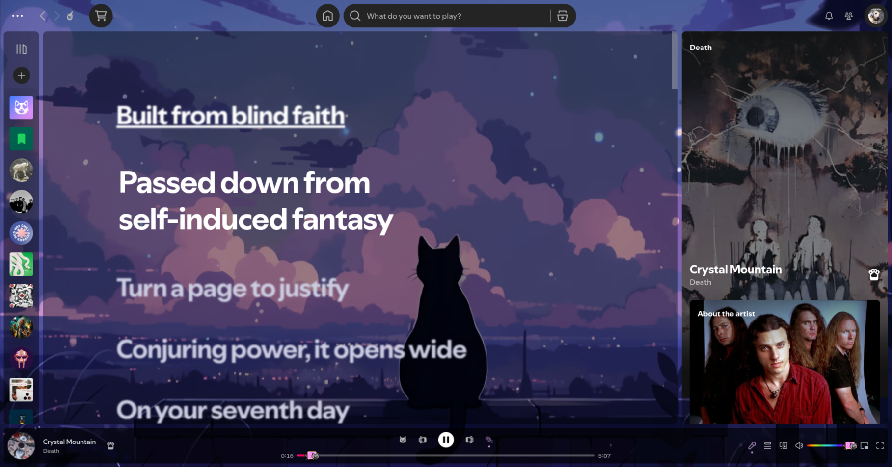 
<p class="-mt-2 text-center text-sm text-gray-500 italic dark:text-gray-400">catppuccin theme all over again with cool snippets of lyric sniping & disc rotating, while not visible on this image</p>

and accompanied with cava visualizer as a widget in desktop 

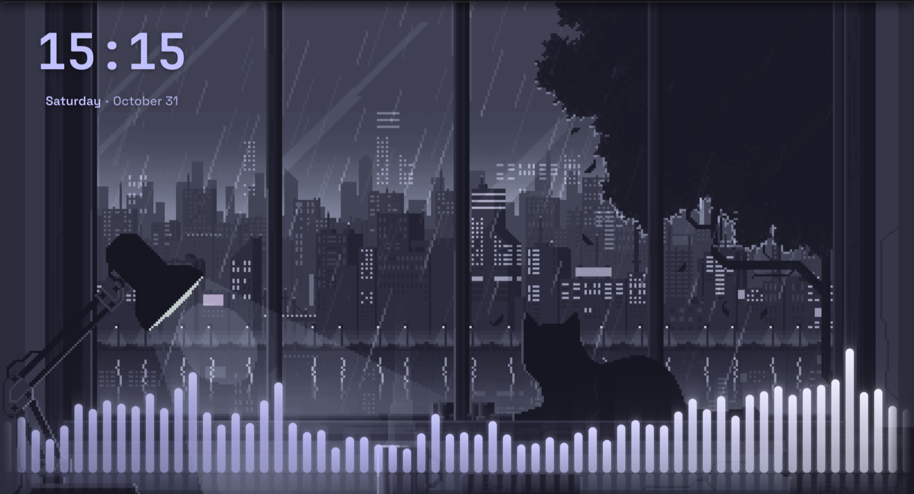

All these are CSS injections possible via [spicetify](https://spicetify.app/), great app, would highly recommend!

### Steam 

Another set of CSS-injections keep on coming baby

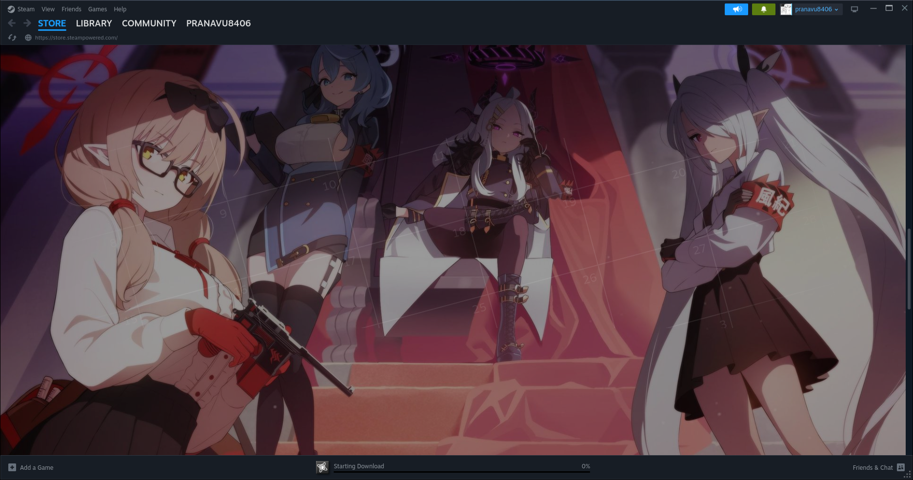

Not a fan of the animu wallpaper, will change it in future if I care and I have time but yeah if you wanna check this out, go [here](https://steambrew.app/)

Speaking of which anyone here wants to add me as a friend on steam, please go ahead and do so, my friendcode is: 

```text 
1510359688
```

We can prolly play buckshot-roulette together or smthg idk

### Discord 

While I am no longer active on sisscord, I do intend to come back on the platform. I have similar catppuccin themes and neat typography to go along with it:

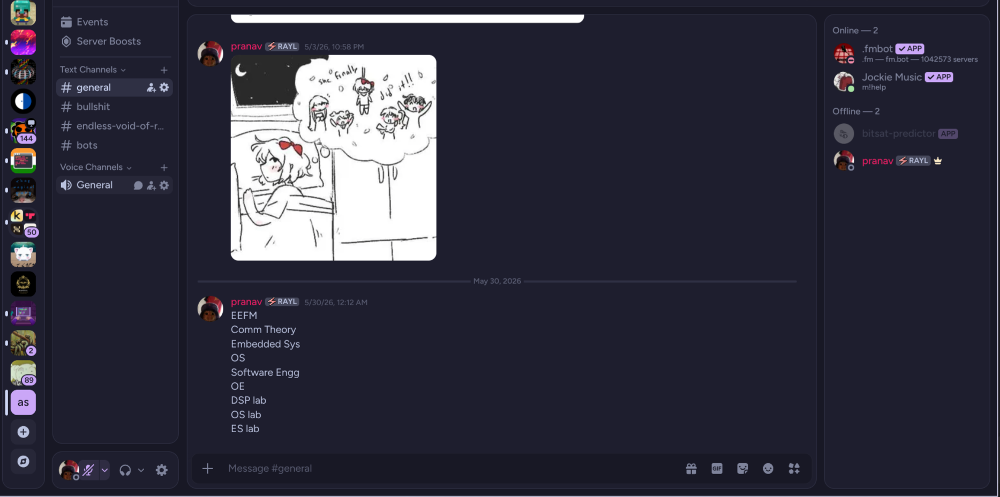
<p class="-mt-2 text-center text-sm text-gray-500 italic dark:text-gray-400">opening discord after an eternity</p>

thanks to [vesktop](https://vesktop.dev/)

again highly recommend checking these out!

## Config 

I stumbled across this [website](https://ryoku.dev/) a while back and ngl looked pretty cool so without backing up anything, I chose to directly install the script (NOT RECOMMENDED), from what I can tell this seems like a very quickshell aah setup and something that you could also garner from going through my setup so far.

It is made in forth by the same guy who worked on omarchy which I am not really a big fan of, however I do dig this, very design-oriented and maximalist by it. There are some redundant features here (for me, personally) however as an overall experience it's pretty nice, again would recommend

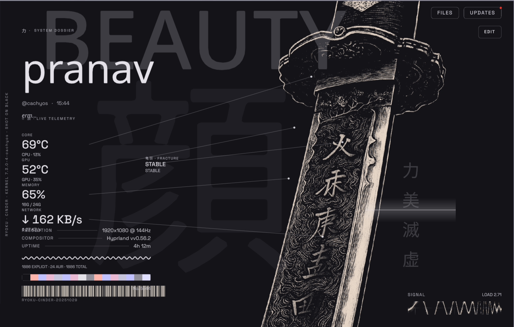
<p class="-mt-2 text-center text-sm text-gray-500 italic dark:text-gray-400">Like man lmao, what is this? but whatever it is, looks cool af</p>

I (might) abandon this entire setup as well after some point, who knows? If I ever choose to create my own rice, I will defo share the dotfiles with yall but today anyways I am sharing the setup I am using at the moment which I do think is quite vibrant and something many of y'all might enjoy

## Final Thoughts 

Of course, if you are a newbie to linux ricing, this post might give you some insight I suppose, although a lot of these are my recommendations and stuff I am using at the moment, you need not necessarily copy all these utilities but rather only choose those which you might find convenient 

Again as always, do share your linux (or even win11/macOS rice if you have) in the comment-section, I will be sure to try them all if I can!

Have a good day, expect a new blog soon!